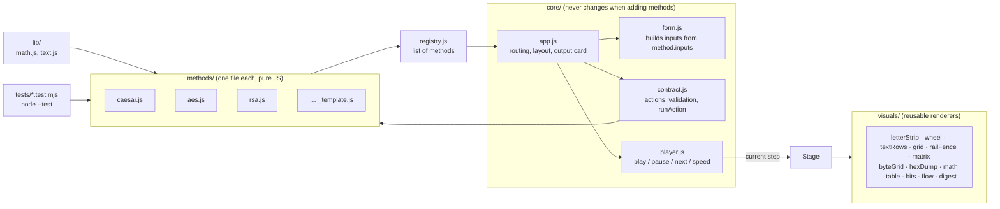

# Kryptonite

**Kryptonite — see cryptography step by step.** Built by **Team Kryptonite**.

A classroom tool that shows **how cryptographic algorithms work, step by step**. Pick a method, type your own message and key, and play through every step with an animation and a plain-English explanation. It replaces jumping between many separate websites during a lecture.

**Live demo:** https://team-kryptonite.vercel.app

| Classical | Modern | Other |
|---|---|---|
| Caesar (+ brute-force attack demo) · Vigenère · Playfair · Rail Fence · Hill (2×2) | AES-128 (all 10 rounds + key expansion) · RSA (key generation + square-and-multiply) · Diffie–Hellman | SHA-256 (padding, message schedule, 64 rounds, avalanche) · Base64 (encoding ≠ encryption) |

Features
- Step player: play / pause, previous / next, first / last, speed (0.5×–4×), scrubber, jump-to-step list, keyboard shortcuts (← → Space Home End, Ctrl+Enter to run).
- Encrypt → Decrypt round trip in one click (the output is carried over).
- Light mode by default with a pure-black dark mode, and a layout that works on phones.
- Works offline: fonts (IBM Plex Sans + Plex Mono, SIL OFL 1.1, `assets/fonts/`) and the logo are bundled — no CDN.
- Design system and logo: see [`docs/design.md`](docs/design.md); logo files in `assets/` (`logo.svg`, `logo-dark.svg`, `logo-mono.svg`, `logo-mark.svg`, `favicon.svg`).
- Friendly validation (e.g. "p = 4 is not prime", "this Hill key cannot be inverted").
- Everything runs in the browser: no backend, no build step, no tracking.
- Correctness checked by automated tests against published test vectors (FIPS-197, SHA-256, RFC 4648, textbook examples).

## Run it

It is a static site. Any web server works (ES modules do not load from `file://`).

```bash
git clone https://github.com/vishal-1307/kryptonite.git
cd kryptonite
python3 -m http.server 8080        # or: npx serve .
# open http://localhost:8080
```

Run the tests (Node 18+; no dependencies to install):

```bash
node --test          # or: npm test
```

Deploy: drop the folder on Vercel, Netlify, GitHub Pages or any static host. No configuration needed.

## Architecture



```
index.html, styles.css   page shell and design
core/                    app shell, step player, auto form builder, validation
visuals/                 reusable visual renderers + visuals/index.js registry
methods/                 one file per algorithm (+ _template.js)
lib/                     shared math (gcd, modular inverse, modPow) and text/byte helpers
registry.js              the list of methods: one line per method
tests/                   node --test unit tests with standard test vectors
docs/                    notes for the project report
```

How a run works:
1. `registry.js` lists the method objects.
2. The app builds the input form from `method.inputs` and the buttons from `method.actions`.
3. On **Run**, the core validates the inputs and calls `method[action](values)`.
4. The method returns `{ output, steps }`. Each step is `{ title, explanation, visual }`.
5. The step player shows one step at a time; each `visual.type` is drawn by the matching renderer in `visuals/`.

Methods are **pure functions** (no DOM access), so the same code is used by the browser and by the tests.

## How to add a new method

Adding a method never touches `core/`. It takes one file and one line.

1. Copy the template:
   ```bash
   cp methods/_template.js methods/atbash.js
   ```
2. Edit the new file: set `id`, `name`, `category`, `description`, the `inputs` and the `encrypt` / `decrypt` functions (the template is a complete, working Atbash cipher).
3. Register it in `registry.js`:
   ```js
   import atbash from './methods/atbash.js';
   export const methods = [ caesar, /* … */, atbash ];
   ```
4. Reload the page. The sidebar, home card, input form, buttons and step player all appear automatically.
5. (Recommended) add a test with a known example to `tests/methods.test.mjs`. The existing contract test already checks every registered method returns valid steps.

### The method contract

```js
export default {
  id: 'atbash',                       // unique, used in the URL: #/atbash
  name: 'Atbash Cipher',
  category: 'Classical',              // groups it in the sidebar; new categories are added automatically
  description: 'Mirror the alphabet.',
  ioField: 'text',                    // input that holds the message (enables Encrypt → Decrypt round trip)
  inputs: [
    { id: 'text', label: 'Message', type: 'textarea', default: 'Hello' },
    { id: 'shift', label: 'Shift', type: 'number', default: 3, min: 0, max: 25,
      validate: (v) => (v >= 0 && v <= 25 ? null : 'Shift must be 0–25'),
      showFor: ['encrypt', 'decrypt'] },          // optional
  ],
  actions: [ { id: 'encrypt', label: 'Encrypt' }, { id: 'decrypt', label: 'Decrypt' } ], // optional (this is the default)
  examples: [ { label: 'Textbook', values: { text: 'ATTACK' } } ],                         // optional
  validate: (values, action) => null,                                                     // optional cross-field check
  encrypt(values) { return { output: '…', steps: [ /* … */ ] }; },
  decrypt(values) { return { output: '…', steps: [ /* … */ ] }; },
};
```

Input `type` can be `text`, `textarea`, `number` or `select` (with `options: [{ value, label }]`).
Throw `new Error('friendly message')` for invalid input; it is shown under the form.

A **step** looks like:

```js
{
  title: 'A → D',
  explanation: 'A is letter 0. Add 3 → 3, which is D.',
  visual: [                                   // one visual or an array of them
    { type: 'wheel', data: { shift: 3, active: 0 } },
    { type: 'math',  data: { lines: [{ expr: '(0 + 3) mod 26 = 3', highlight: true }] } },
  ],
}
```

### Built-in visuals

| type | use it for | data |
|---|---|---|
| `letterStrip` | alphabet mappings | `{ top[], bottom[], labelTop, labelBottom, active? }` |
| `wheel` | Caesar-style rotation (animated) | `{ shift, active? }` |
| `textRows` | aligned plaintext / key / ciphertext rows | `{ rows: [{ label, cells[] }], active? }` |
| `grid` | Playfair-style letter squares | `{ cells[][], primary?: [r,c][], secondary?: [r,c][], caption? }` |
| `railFence` | zigzag transposition | `{ rails, cols, cells: [{ r, c, ch }], active?, caption? }` |
| `matrix` | matrix × vector | `{ items: [{ kind: 'matrix', label, values[][] } \| { kind: 'op', text }] }` |
| `byteGrid` | AES 4×4 states | `{ items: [{ label, bytes[16], hl?, tone? } \| { op }], rowShift? }` |
| `hexDump` | bytes with coloured segments | `{ bytes[], segments: [{ from, to, tone, label }] }` |
| `math` | equations / modular arithmetic | `{ lines: [{ expr, note?, highlight? }] }` |
| `table` | any table | `{ headers[], rows[][], highlightRows?, mono?, compact?, scroll? }` |
| `bits` | bit groups (Base64) | `{ groups: [{ label, items: [{ top, bottom, accent? }] }] }` |
| `flow` | parties / channels (DH, key pairs) | `{ columns: [{ title, items: [{ text, highlight? }] }] }` |
| `digest` | long hex values, with diff highlight | `{ label, hex, compare? }` |

A new visual is also one file: create `visuals/<name>.js` exporting `{ type, render(data) => Element, update?(el, data) }` and add it to `visuals/index.js`.

## Correctness

`node --test` checks, among others:
- AES-128 against **FIPS-197 Appendix B** (including round-1 intermediate states) and **Appendix C.1**, plus 25 random blocks against Node's built-in AES.
- SHA-256 for `""`, `"abc"`, the 448-bit NIST message, padding edge cases (55/56/64 bytes) and Unicode, compared with Node's `crypto`.
- RSA with p = 61, q = 53, e = 17 → d = 2753, 65 ↔ 2790; Diffie–Hellman p = 23, g = 5, a = 4, b = 3 → secret 18.
- Vigenère `ATTACKATDAWN` / `LEMON` → `LXFOPVEFRNHR`; Playfair "Hide the gold in the tree stump" → `BMODZBXDNABEKUDMUIXMMOUVIF`; Rail Fence `WEAREDISCOVEREDFLEEATONCE` (3 rails) → `WECRLTEERDSOEEFEAOCAIVDEN`; Hill `HELP` with [[3,3],[2,5]] → `HIAT`; Base64 RFC 4648 vectors.
- Every method round-trips and returns well-formed steps.

- Educational fixes (pass-through characters, Vigenère key progression, Playfair fillers, exact Hill key reduction, AES byte lengths and PKCS#7, RSA definitions, degenerate Diffie–Hellman parameters, one-bit SHA-256 avalanche, Base64 decoding order and BOM) in `tests/methods-fixes.test.mjs`.

> Educational use: AES here encrypts a single block (no mode of operation, IV or authentication), RSA is "textbook" RSA with tiny primes and no OAEP/PSS padding, and Diffie–Hellman uses tiny unauthenticated groups, so every step is visible. The default inputs are demonstration values. Use real libraries (Web Crypto, OpenSSL, libsodium) for actual security.

## Code examples (`code/`)

Each method has a hand-written **Python 3** (standard library only) and **C++17** (standard library only) program in `code/<method>/`, with the same sample input and output format as the web page. AES-128 and SHA-256 also have a library route (`aes128_lib.py` with `cryptography`, `sha256_lib.py` with `hashlib`). The AES functions use the visualizer's names (`key_expansion`, `sub_bytes`, `shift_rows`, `mix_columns`, `add_round_key` / `KeyExpansion`, `SubBytes`, …).

```sh
cd code/caesar && python3 caesar.py                                   # Dwwdfn dw gdzq
cd code/caesar && g++ -std=c++17 -O2 caesar.cpp -o caesar && ./caesar  # Dwwdfn dw gdzq
sh code/verify.sh        # compiles and runs all programs and compares them with the JS methods
node code/make-manifest.mjs   # regenerates code/manifest.json (read by the Code tab)
```

`code/STEP_FIELDS.md` documents the optional `step.meta` data the methods emit for animations (Vigenère key index, Playfair cells and fillers, Rail Fence active position, Hill row products, RSA Euclid/square-and-multiply, Diffie–Hellman exchange, SHA-256 registers, Base64 decoding groups). All programs are teaching code, not production cryptography.

## Privacy and security headers

Everything runs in the browser: the app makes no network requests with your messages or keys (no `fetch` of user data, no analytics, no beacons; the only requests are for the site's own static files). `vercel.json` sets a strict Content-Security-Policy (`'self'` only, no inline styles, `object-src 'none'`, `frame-ancestors 'none'`), `X-Content-Type-Options: nosniff`, `X-Frame-Options: DENY`, `Referrer-Policy: strict-origin-when-cross-origin` and a minimal `Permissions-Policy`. Vercel adds HSTS itself. If you change the inline script in `index.html`, update its `sha256-…` hash in `script-src` (or move the script to a file and drop the hash).

## Team

Kryptonite is built and maintained by **Team Kryptonite**.

## License

MIT
